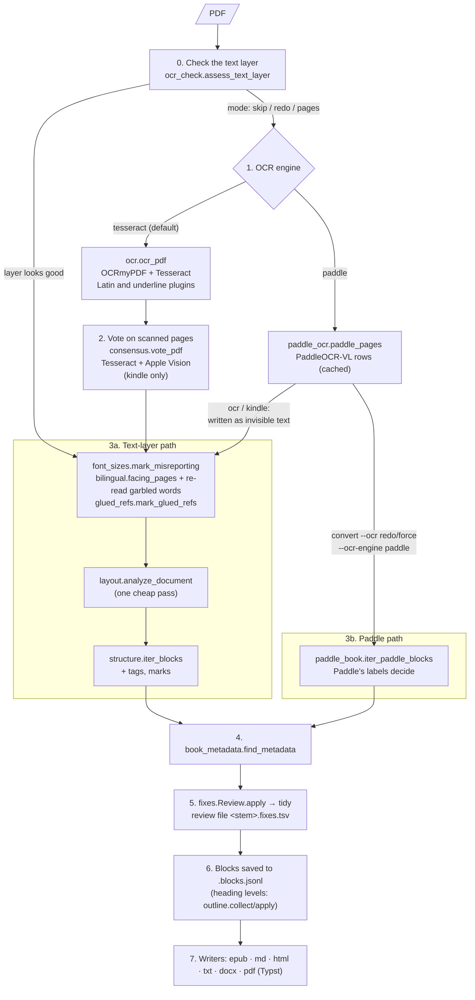
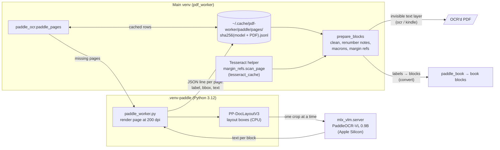

# The PDF pipeline, and how OCR works in it

An overview of how `convert` and `kindle` turn a PDF into a book, with the OCR in
detail. The source code is the reference: names below are modules in `src/pdf_worker/`.
Measured numbers come from `docs/ocr-plan.md` and the module docstrings.

## 1. Overview

Every stage works one page at a time and streams its output. The core is
`convert.convert_pdf`. OCR happens before it and only decides which PDF, or which
Paddle rows, `convert_pdf` receives.

A key design choice: **the Tesseract path produces a normal PDF with an invisible text
layer.** Everything after that (layout, footnotes, structure) works the same on a scan
as on a born-digital PDF. Corrections are never written into the text layer itself.
They are stored as private keys on each page (`/PdfWorkerFixes`,
`/PdfWorkerMarginRefs`, `/PdfWorkerGluedRefs`, `/PdfWorkerSameLeading`), and
`layout.page_lines` applies them whenever it reads a line. Every command and tool
therefore sees the same corrected words, with their original positions and sizes.

## 2. Does the PDF need OCR? (`ocr_check.py`)

`assess_text_layer` samples about 24 pages spread evenly through the book. For each page
it measures:

- **Has text**: the page has non-empty lines.
- **Scanned**: one image covers at least 80% of the page.
- **Jittery lines**: words on the same line differ in font size by more than 25%. This
  is the sign of a word-by-word layer, like archive.org's.
- **Suspect words**: digits inside words (`0RBERG`), symbols inside words, or a capital
  after lowercase letters (`liBer`).

The result decides the OCR mode, checked in this order:

| Condition | Mode |
|---|---|
| Fewer than 50% of pages have text | `skip` (OCR only the pages without text) |
| Scanned, and more than 20% of lines are jittery | `redo` (replace the layer) |
| Scanned, and more than 1% of words are suspect | `redo` |
| Scanned, and some pages have no text | `skip` |
| Scanned, with hand-drawn underlines | `redo` on **those pages only** |
| Anything else | no OCR |

The three modes:

- **skip**: OCR only the pages that have no text.
- **redo**: drop an existing OCR layer and read the page again. Real digital text is
  kept.
- **force**: rasterize every page and OCR it. Any digital text is lost.

## 3. Engine 1: Tesseract via OCRmyPDF (default, `ocr.py`)

`ocr_pdf()` runs these steps:

1. **Language guess** (`guess_ocr_languages`):
   - It samples the existing text layer from about 12 pages.
   - If that gives fewer than 500 characters, it runs a quick probe instead: Tesseract
     on 3 pages spread through the book, at 150 dpi, reading in `eng+grc`.
   - `convert.guess_language` counts stopwords for en, es, fr, de, it, pt and la, and
     maps the winner to a Tesseract code (`es → spa` and so on).
   - If the sample contains at least 20 Greek letters, `grc` is added.
   - Any language model that isn't installed gives a clear error with a `brew install`
     hint.
2. **Preparing the source copy** (`_ocr_source_copy`, using pikepdf):
   - It removes reader markup annotations (highlights, ink, notes) so they are neither
     read nor kept. Links and form fields stay.
   - Spread scans (ABBYY) can have a MediaBox like `[330 0 660 518]`. Each such page is
     shifted to start at (0, 0), otherwise OCRmyPDF places the text off the page.
3. **Plugins**, which are OCRmyPDF hooks loaded by module name so its worker processes
   can import them:
   - **`ocr_latin_plugin`**, active when `lat` is among the languages. It wraps
     Tesseract's engine. After Tesseract writes its hOCR and text output, each
     *paragraph* that reads as Latin gets `macrons.restore_macrons`. Tesseract's Latin
     model has no macrons, so it writes `à/á/ä/â/ã/ă/å` and doubled vowels (`Maàrcus`)
     where the page has a long vowel. These become `ā`, and repeated long vowels are
     collapsed. Whether a paragraph "reads as Latin" is decided by stopwords against
     the other languages being OCR'd, with Latin-only endings (`-um`, `-orum`, `-ibus`)
     breaking ties. Spanish or French passages therefore keep their real accents.
   - **`ocr_underline_plugin`**, active only when a sampled page has underlines, or
     when `pages` is given. It hooks `filter_ocr_image`: it scales images finer than
     400 dpi down to 300 dpi, converts them to black and white, and erases the
     underlines. Only the image Tesseract reads changes; the page the reader sees does
     not. It isn't applied to every book because decoding the image alone changed
     Tesseract's output (Familia Romana lost macrons).
4. **`ocrmypdf.ocr(...)`** runs with `output_type="pdf"` (no PDF/A, so no Ghostscript
   needed), the chosen `mode`, `pages` and `jobs`, and the plugins. OCRmyPDF's
   exceptions are mapped to `PdfWorkerError` subclasses. The output is written
   atomically (temporary file, then `os.replace`). The report lists the pages that
   were empty before and after.

### How underlines are detected (`underlines.py`)

- It finds connected ink components no taller than 8 px (at 300 dpi).
- Using union-find, it chains components that are at most 25 px apart horizontally and
  at most 5 px apart vertically.
- A chain of 3 or more fragments that is at least 80 px long is a hand-drawn (broken)
  underline. A thin solid run of at least 160 px is erased too, but isn't counted.
- A page with 3 or more broken underlines counts as underlined. Printed rules, such as
  a footnote separator, are one solid line and don't count.
- On the sample book, an underlined page went from 85% to 95% word recall.

## 4. The vote: consensus OCR (`consensus.py`, `kindle` only)

This runs only when at least 50% of sampled pages are scanned and the engine is
Tesseract:

1. Each scanned page is rendered at 300 dpi in greyscale, with underlines erased.
2. It is read again by **Apple Vision** (`ai_client.apple_vision`, using ocrmac) and by
   **Tesseract**. Pages that Tesseract itself just OCR'd use the *original* scan's
   layer as the second reading instead, because the same engine twice would just agree
   with itself. Tesseract results are cached on disk (`tesseract_cache`, keyed by a
   hash of the image and the arguments).
3. `difflib` aligns each reading with the page's own words. Only equal-length `replace`
   stretches cast votes.
4. A word is replaced only when **every** other reading agrees on the same different
   word, **and** that word appears elsewhere in the book more often than the old one.
   Adding an accent always passes (`si → sí`); removing an accent never happens.
5. The fixes are stored as `[bbox, old, new]` under `/PdfWorkerFixes` and applied by
   `page_lines`.

On Platón VI, recall went from 92.4% to 93.2% on clean pages and from 94.5% to 96.7%
on underlined ones. Without Apple Vision, the vote is skipped.

## 5. Engine 2: PaddleOCR-VL-1.6 (opt-in)

Modules: `paddle_ocr.py`, `paddle_worker.py`, `paddle_book.py`.

### Architecture: three processes

1. An **MLX-VLM server** (started through `ai_client.mlx_vlm`) serves the 0.9B
   PaddleOCR-VL model on Apple Silicon. The first request downloads about 2 GB.
2. **`paddle_worker.py`** runs in a *separate* venv (`.venv-paddle`, Python 3.12,
   because PaddlePaddle has no wheels for newer versions; override with
   `PDF_WORKER_PADDLE_PYTHON`).
   - It renders each page at 200 dpi.
   - It runs `PaddleOCRVL`: the PP-DocLayoutV3 layout model on the CPU finds the boxes,
     and the VLM server reads each crop. Concurrency is set to 1 because mlx_vlm fails
     on concurrent crops of different sizes.
   - For each page it writes one JSON line: `{page, width, height, blocks:[{label,
     bbox, text}]}`.
   - It reports progress as `paddle: page N/M` on stderr.
3. The main process parses that output.

`--layout-only` runs just the layout model at 150 dpi, with no server. It gives
labelled boxes that the text-layer path can use as `layout_rows`.

### Caching

Rows are cached in `~/.cache/pdf-worker/paddle/pages/<sha256(model + PDF bytes)>.jsonl`
(the folder is `PDF_WORKER_PADDLE_CACHE` or `--paddle-cache`). Paddle's output varies
from run to run, so the cache makes rebuilds fast and repeatable. If a run is
interrupted, the pages already finished are kept and the next run continues from there.

### Two ways to use Paddle

- **`ocr --engine paddle`** and **`kindle --engine paddle`**: `_write_text_layer` writes
  Paddle's blocks back into the PDF as invisible text (Noto Sans, `render_mode=3`),
  justified, in Paddle's reading order. To keep the size-based rules working:
  - One body size is used per page, the size the longest block fits at.
  - Footnotes are written at 0.8 of the body size.
  - Text is shrunk in 4% steps so a body paragraph is never mistaken for a note-sized
    one.
  - Any existing layer is removed first, using redactions that keep images and
    drawings.
- **`convert --ocr redo|force --ocr-engine paddle`**: this path is better. It **skips
  the text layer** and builds the book directly from Paddle's labels
  (`paddle_book.iter_paddle_blocks`):
  - Titles become headings.
  - `text` blocks become paragraphs. A paragraph continues across pages when the
    previous one ended mid-sentence or the next starts in lowercase.
  - `footnote` blocks become notes, labelled per part (`c<part>-<n>`). A part starts
    again whenever the count restarts at 1.
  - `aside_text` becomes glosses, and `algorithm` blocks (tables of Greek variants)
    become one small line each.
  - Running heads and page numbers are removed by the same rule as the text-layer path
    (`furniture`). Paddle's labels aren't trusted for this because it calls a running
    head a title.
  - The first pages with fewer than 60 words (title pages) and printed contents pages
    are left out.
  - Marks files (`book.marks.json`) override Paddle's labels.

### Cleaning Paddle's output (`prepare_blocks`, used by both ways)

- **`clean_text`**:
  - Removes LaTeX: `$ \text{Āfricā} $` becomes `Āfricā`, and `^{12}` becomes `¹²`.
  - A 4-digit superscript ending in 7 is read as a question mark misread as 7
    (`^{1267}` becomes `¹²⁶?`).
  - Flattens HTML tables. A table of 30 or more words with less than 30% distinct words
    is discarded as a looping hallucination (mosaics read as tables).
- **Labels**:
  - A `footer` that starts with a number and words is relabelled as a footnote.
  - Printer's signatures (`160. — 18`) are dropped.
  - Ticks in the margin and bare margin marks are dropped. Margin references are found
    in the scan instead (see below).
- **Layout**:
  - Wide blocks are snapped to one left edge, because Paddle's boxes wobble and would
    otherwise read as indentation.
  - Printed line breaks are joined and hyphenation removed.
  - A paragraph start is marked with typed indentation.
- **Macrons**: `text_settings` decides once for the whole book whether Latin is
  present, and which other languages compete with it. Each block then gets
  `restore_macrons_if_latin`, which also covers Paddle's `å` and `ô`.
- **Hallucinated scripts**: a block with at least 3 letters (and at least 5%) of
  Vietnamese, Arabic or CJK is replaced with **Tesseract's reading of the same box**. A
  few stray foreign letters are patched word by word (`_patch_foreign`).
- **Digits inside words** (`FILE0`): Tesseract's all-letter reading of the aligned word
  wins, with the original case kept.
- **Characters the font lacks** fall back to their base letter (`ἐ → ε`), else `?`.

### Tesseract as Paddle's helper

Paddle is the main reader, but a Tesseract scan of each page (`margin_refs.scan_page`,
through `page_scanner`) fills Paddle's gaps:

- **Margin references** (Stephanus `22b` and similar): Paddle drops or garbles them.
  The ink beside the text column is read on its own, matched to Paddle's words
  (`mark_paddle_blocks`) and labelled across the whole book (`assign_labels`).
- **Footnote numbering** (`note_numbers`):
  - Notes count up through the book, so a page's notes take the numbers that follow
    the previous page's last note.
  - References in the text are renumbered to match (`fix_refs`).
  - A reference that was dropped is put back where Tesseract saw a stray mark after a
    word.
  - Notes Paddle skipped are recovered from Tesseract's lines at the foot of the page
    (`_recover_notes`).
  - When the printed page number jumps forward (pages missing from the scan),
    numbering resets to that page's first reference.
- **Missing references** (`missing_refs`): three tries, cheapest first. (1) the PDF's
  old text layer; (2) Tesseract at high resolution on just those lines; (3) Paddle
  again on a crop of those lines. A try counts only when it finds exactly one matching
  word, and that word occurs exactly once in Paddle's text.
- **Greek mixed with Latin** (`mixed_script`): Paddle reads polytonic Greek as Latin
  look-alikes (`tà šèovta`). Those lines are read twice, with Tesseract `grc` and with
  the book's language, and for each word the more confident reading wins.
- **Styles** (`styles.py`): italics, bold and accents are copied word by word from the
  scan's old text layer, which knows its fonts, onto Paddle's better words.
- **Spanish fixes**: `¿` and `¡` misread as `i`, `l` or `2` are restored. Vietnamese
  letters are mapped back to Spanish accents.

### Why Paddle is opt-in

From `docs/ocr-plan.md`:

- On Familia Romana with the macron fix, Paddle reached about 98% word recall and 94%
  long-vowel recall, against Tesseract's 81% and 44%.
- But it takes **12–24 s per page**, against about 1 s for Tesseract. That's roughly
  1.5–2 hours for a 332-page book, so it suits overnight runs.

## 6. OCR fixes on the text-layer path (`convert_pdf`)

These run on OCR'd PDFs, and on any PDF with a poor layer:

- **`font_sizes.mark_misreporting`**: ClearScan-style OCR (hundreds of fonts made from
  letter shapes) reports nonsense font sizes. Each line's size is taken instead from
  its **leading**, the spacing between lines, using the median size per leading across
  the book.
- **`bilingual.facing_pages`**: in bilingual editions, pages of Greek original are left
  out.
- **`_reread_words`**: with Tesseract and `grc` installed, garbled words are read again
  line by line, in Greek and in the book's language. A confident reading replaces the
  word. Uncertain ones are flagged as `greek-unsure` or `reread-unsure`.
- **`glued_refs`**: note numbers flattened onto the line (`inteligentes74•`) become
  superscripts, but only if they count up through the book like notes do.

## 7. The review loop after OCR (`fixes.py`, `pdf-worker review`)

Each build applies `<stem>.fixes.tsv` to the blocks before any writer sees them, then
appends what looks wrong.

**Kinds flagged:**

- `spelling`: rare words, checked by ai-client's `check.text`.
- `chars`: odd letters, such as stray macrons outside Latin, Cyrillic look-alikes,
  stray `$`.
- `note-no-ref` and `ref-no-note`.
- `margin-est` and `margin-missing`.
- `greek-unsure` and `reread-unsure`.

**Actions you can set:** `replace`, `ignore`, `attach`, `drop`, `accept`, `move`, `add`.

You fix each item once in the TSV (or on the `review` web page) and the fix applies on
every rebuild. Spelling and character checks run for scans and born-digital books alike.

## 8. Which command does what

| Command | OCR behaviour |
|---|---|
| `ocr in.pdf [--mode] [--lang] [--engine]` | Writes `in.ocr.pdf` with a searchable layer |
| `extract-text/convert --ocr [skip\|redo\|force]` | OCRs into a temporary copy next to the output, then reads that copy. Metadata comes from the original |
| `convert --ocr redo --ocr-engine paddle` | No text layer: the book is built from Paddle's rows |
| `kindle` | Assesses, OCRs automatically with the right mode and pages, votes on scans (Tesseract only), then converts to EPUB. `--no-ocr` disables OCR |
